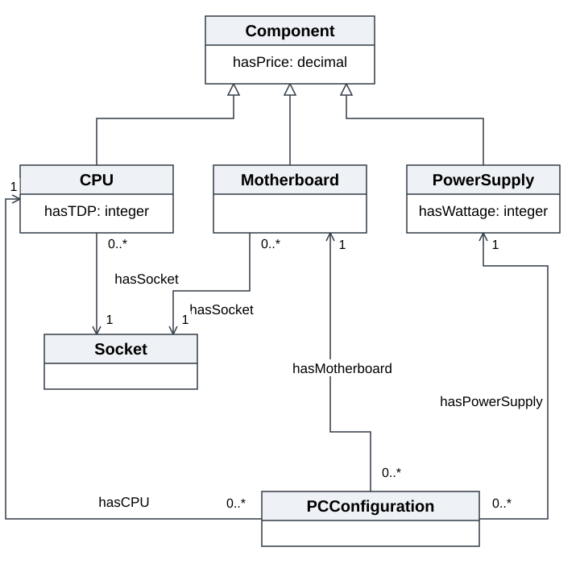

# Практичне заняття 1

# Концептуальна модель PC Builder

**Варіант 1. Конфігуратор комплектуючих ПК.**

Мета роботи - визначити поняття предметної області, їхню ієрархію, зв’язки, атрибути та екземпляри і подати модель як UML Class Diagram для подальшої реалізації в OWL.

Модель описує добір процесора, материнської плати та блока живлення. Конфігурацію перевіряють за типом сокета, співвідношенням потужності БП і TDP процесора та сумарною ціною комплектуючих.

## Класи та ієрархія

| Клас | Зміст | Батьківський клас |
| --- | --- | --- |
| Component | Загальне поняття комплектуючої з ціною | - |
| CPU | Процесор із сокетом і значенням TDP | Component |
| Motherboard | Материнська плата з певним сокетом | Component |
| PowerSupply | Блок живлення із заданою потужністю | Component |
| Socket | Тип інтерфейсу встановлення процесора | - |
| PCConfiguration | Набір із процесора, плати та блока живлення | - |

CPU, Motherboard і PowerSupply спеціалізують Component та успадковують hasPrice. Socket і PCConfiguration є окремими поняттями. Три види комплектуючих попарно несумісні; тип сокета та конфігурація не є комплектуючими.

## Атрибути об’єктів

| Атрибут | Клас | Тип та значення |
| --- | --- | --- |
| hasPrice | Component | decimal; ціна ≥ 0 |
| hasTDP | CPU | integer; TDP > 0, Вт |
| hasWattage | PowerSupply | integer; потужність > 0, Вт |

Назви класів і властивостей відповідають варіанту завдання. Числові приклади є навчальними; ціни задано в умовних грошових одиницях.

## UML діаграма класів

Порожній трикутник позначає успадкування. Відкриті стрілки асоціацій спрямовані до пов’язаного об’єкта. 1 означає рівно один об’єкт, 0..* - довільну кількість.

## Відношення та кратність

| Відношення | Від класу | До класу | Кратність |
| --- | --- | --- | --- |
| hasSocket | CPU або Motherboard | Socket | 1 |
| hasCPU | PCConfiguration | CPU | 1 |
| hasMotherboard | PCConfiguration | Motherboard | 1 |
| hasPowerSupply | PCConfiguration | PowerSupply | 1 |

У зворотному напрямі кратність дорівнює 0..*: один запис каталогу може входити до кількох конфігурацій, а один тип сокета - належати багатьом процесорам і платам. hasSocket показано двома асоціаціями для двох класів.

## Заплановані екземпляри

Заплановано 18 різних індивідів: 3 сокети, 4 CPU, 4 Motherboard, 3 PowerSupply та 4 PCConfiguration. Окремі прямі екземпляри Component не потрібні: його 11 екземплярів належать до спеціалізованих класів.

**Socket:** Socket_AM4, Socket_AM5, Socket_LGA1700.

| Екземпляр | Сокет | TDP / БП, Вт | Ціна |
| --- | --- | --- | --- |
| CPU_AM4_65W | Socket_AM4 | 65 | 120.00 |
| CPU_AM4_105W | Socket_AM4 | 105 | 220.00 |
| CPU_AM5_65W | Socket_AM5 | 65 | 250.00 |
| CPU_LGA1700_125W | Socket_LGA1700 | 125 | 300.00 |
| Motherboard_AM4_A | Socket_AM4 | - | 90.00 |
| Motherboard_AM4_B | Socket_AM4 | - | 140.00 |
| Motherboard_AM5 | Socket_AM5 | - | 180.00 |
| Motherboard_LGA1700 | Socket_LGA1700 | - | 160.00 |
| PSU_450W | - | 450 | 50.00 |
| PSU_650W | - | 650 | 80.00 |
| PSU_750W | - | 750 | 100.00 |

Для CPU у стовпці потужності наведено TDP, для PowerSupply - Wattage. Материнські плати мають сокет і ціну; сокети не мають числових атрибутів.

## Склад конфігурацій

| PCConfiguration | hasCPU | hasMotherboard | hasPowerSupply |
| --- | --- | --- | --- |
| PC_Office_AM4 | CPU_AM4_65W | Motherboard_AM4_A | PSU_450W |
| PC_Performance_AM4 | CPU_AM4_105W | Motherboard_AM4_B | PSU_650W |
| PC_Modern_AM5 | CPU_AM5_65W | Motherboard_AM5 | PSU_650W |
| PC_Intel_LGA1700 | CPU_LGA1700_125W | Motherboard_LGA1700 | PSU_750W |

Кожна конфігурація має рівно три задані зв’язки. Наприклад, PC_Office_AM4 поєднує CPU_AM4_65W, Motherboard_AM4_A та PSU_450W. PSU_650W використано у двох конфігураціях як той самий запис каталогу.

## Умови сумісності та перевірка моделі

Кожна PCConfiguration містить рівно один CPU, одну Motherboard і один PowerSupply. Кожен CPU та кожна Motherboard мають рівно один Socket. Ідентифікатори сокетів процесора і плати конфігурації повинні збігатися.

Навчальна умова живлення: **hasWattage(БП) ≥ hasTDP(CPU)**. Сумарна ціна дорівнює сумі hasPrice трьох комплектуючих. Бюджет виконується, якщо **сумарна ціна ≤ B**; B є зовнішнім параметром добору. У прикладі нижче B = 500.

| Конфігурація | Сокети | TDP / БП, Вт | Сума | Бюджет 500 |
| --- | --- | --- | --- | --- |
| PC_Office_AM4 | Збігаються | 65 / 450 | 260.00 | Так |
| PC_Performance_AM4 | Збігаються | 105 / 650 | 440.00 | Так |
| PC_Modern_AM5 | Збігаються | 65 / 650 | 510.00 | Ні |
| PC_Intel_LGA1700 | Збігаються | 125 / 750 | 560.00 | Ні |

Усі чотири приклади задовольняють навчальні умови сокета та живлення; дві конфігурації вкладаються у бюджет 500. Наприклад, заміна плати PC_Office_AM4 на Motherboard_AM5 порушує умову збігу сокетів. Перевірка живлення охоплює лише параметри заданого варіанта.

## Елементи для подальшої реалізації в OWL

| Елемент UML | Елемент OWL та склад |
| --- | --- |
| Класи | 6 owl:Class: Component, CPU, Motherboard, PowerSupply, Socket, PCConfiguration |
| Успадкування | 3 rdfs:subClassOf: CPU, Motherboard, PowerSupply → Component |
| Асоціації | 4 Object Properties: hasSocket, hasCPU, hasMotherboard, hasPowerSupply |
| Атрибути | 3 Data Properties: hasPrice, hasTDP, hasWattage; типи xsd:decimal та xsd:integer |
| Екземпляри та факти | 18 Named Individuals; 20 об’єктних зв’язків; 18 числових значень |
| Умови структури | Domain, Range, Functional, DisjointClasses та exactly 1 для потрібних зв’язків і значень |

Для hasSocket Domain планується як об’єднання CPU або Motherboard. Сума цін, бюджет B і порівняння Wattage з TDP перевіряються обчисленням; вони не є додатковими Data Properties заданого варіанта.

**Перевірка повноти.** Модель містить усі шість понять, чотири відношення й три атрибути з опису. Вона представляє склад конфігурації, типи сокетів, TDP, потужність і ціни та надає дані для трьох навчальних перевірок.

Джерела: умова практичного заняття 1, варіант 1; OMG UML 2.5.1 (omg.org/spec/UML/2.5.1); W3C OWL 2 Primer (w3.org/TR/owl2-primer/).
