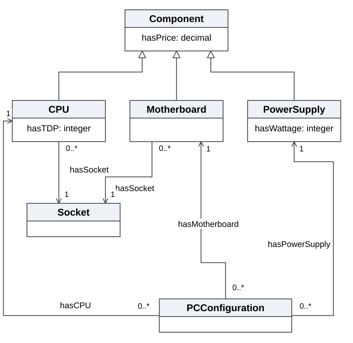

# Практичне заняття 1

**Варіант 1. Конфігуратор комплектуючих ПК (PC Builder)**

## UML-діаграма класів

## Класи, ієрархія та атрибути

| Клас | Батьківський клас | Атрибут і тип |
| --- | --- | --- |
| Component | - | hasPrice (decimal) |
| CPU | Component | hasTDP (integer) |
| Motherboard | Component | - |
| PowerSupply | Component | hasWattage (integer) |
| Socket | - | - |
| PCConfiguration | - | - |

## Відношення

| Відношення | Від класу | До класу | Кратність |
| --- | --- | --- | --- |
| hasSocket | CPU або Motherboard | Socket | 1 |
| hasCPU | PCConfiguration | CPU | 1 |
| hasMotherboard | PCConfiguration | Motherboard | 1 |
| hasPowerSupply | PCConfiguration | PowerSupply | 1 |

Зворотна кратність усіх зв’язків: 0..*.

## Заплановані екземпляри

Сокети: Socket_AM4, Socket_AM5, Socket_LGA1700.

| Екземпляр | Сокет | TDP / БЖ, Вт | Ціна |
| --- | --- | --- | --- |
| CPU_AM4_65W | Socket_AM4 | 65 | 120.00 |
| CPU_AM4_105W | Socket_AM4 | 105 | 220.00 |
| CPU_AM5_65W | Socket_AM5 | 65 | 250.00 |
| CPU_LGA1700_125W | Socket_LGA1700 | 125 | 300.00 |
| Motherboard_AM4_A | Socket_AM4 | - | 90.00 |
| Motherboard_AM4_B | Socket_AM4 | - | 140.00 |
| Motherboard_AM5 | Socket_AM5 | - | 180.00 |
| Motherboard_LGA1700 | Socket_LGA1700 | - | 160.00 |
| PSU_450W | - | 450 | 50.00 |
| PSU_650W | - | 650 | 80.00 |
| PSU_750W | - | 750 | 100.00 |

| Конфігурація | hasCPU | hasMotherboard | hasPowerSupply |
| --- | --- | --- | --- |
| PC_Office_AM4 | CPU_AM4_65W | Motherboard_AM4_A | PSU_450W |
| PC_Performance_AM4 | CPU_AM4_105W | Motherboard_AM4_B | PSU_650W |
| PC_Modern_AM5 | CPU_AM5_65W | Motherboard_AM5 | PSU_650W |
| PC_Intel_LGA1700 | CPU_LGA1700_125W | Motherboard_LGA1700 | PSU_750W |

## Перевірка моделі

PC_Office_AM4: сокети збігаються (AM4), БЖ 450 Вт ≥ TDP 65 Вт, ціна 260 ≤ бюджет 500.
