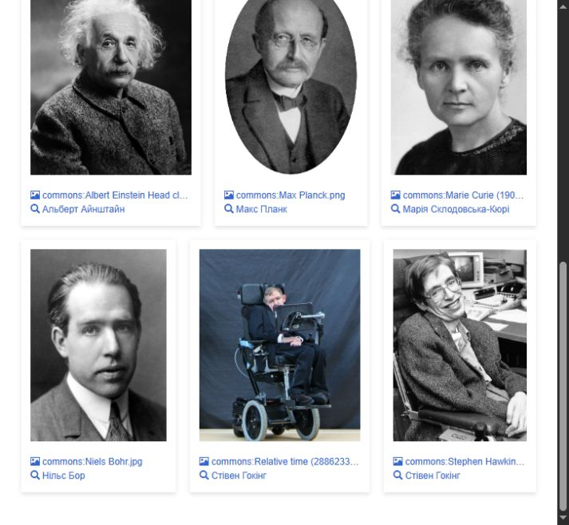
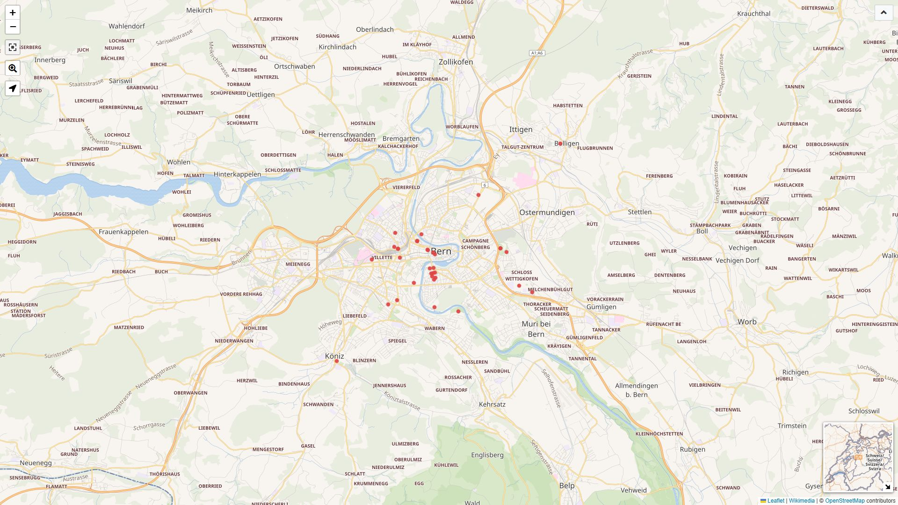

# Практичне заняття 6

## Запити до Wikidata Query Service

Обрана сутність: Альберт Айнштайн (Q937). Мета: отримати базові, часові, медійні та геопросторові дані за допомогою SPARQL.

## 1 Дата і місце народження

```sparql
PREFIX wd: <http://www.wikidata.org/entity/>
PREFIX wdt: <http://www.wikidata.org/prop/direct/>
PREFIX wikibase: <http://wikiba.se/ontology#>
PREFIX bd: <http://www.bigdata.com/rdf#>

SELECT ?person ?personLabel ?birth ?birthplace ?birthplaceLabel WHERE {
  VALUES ?person { wd:Q937 }
  ?person wdt:P569 ?birth ; wdt:P19 ?birthplace .
  SERVICE wikibase:label { bd:serviceParam wikibase:language "uk,en" . }
}
```

Кількість рядків: 1.

| personLabel | birth | birthplaceLabel |
|---|---|---|
| Альберт Айнштайн | 1879-03-14 | Ульм |

## 2 Громадянство без часового контексту

```sparql
PREFIX wd: <http://www.wikidata.org/entity/>
PREFIX wdt: <http://www.wikidata.org/prop/direct/>
PREFIX wikibase: <http://wikiba.se/ontology#>
PREFIX bd: <http://www.bigdata.com/rdf#>

SELECT ?country ?countryLabel WHERE {
  wd:Q937 wdt:P27 ?country .
  SERVICE wikibase:label { bd:serviceParam wikibase:language "uk,en" . }
}
ORDER BY ?countryLabel
```

Кількість рядків: 7.

| country | countryLabel |
|---|---|
| Q41304 | Веймарська республіка |
| Q159631 | Вюртемберзьке королівство |
| Q183 | Німеччина |
| Q30 | Сполучені Штати Америки |
| Q533534 | Цислейтанія |
| Q39 | Швейцарія |
| Q223050 | апатрид |

wdt:P27 повертає значення громадянства без дат початку та завершення.

## 3 Професії та заняття

```sparql
PREFIX wd: <http://www.wikidata.org/entity/>
PREFIX wdt: <http://www.wikidata.org/prop/direct/>
PREFIX wikibase: <http://wikiba.se/ontology#>
PREFIX bd: <http://www.bigdata.com/rdf#>

SELECT ?occupation ?occupationLabel WHERE {
  wd:Q937 wdt:P106 ?occupation .
  SERVICE wikibase:label { bd:serviceParam wikibase:language "uk,en" . }
}
ORDER BY ?occupationLabel
```

Кількість рядків: 14.

| occupation | occupationLabel |
|---|---|
| Q2896489 | patent examiner |
| Q1622272 | викладач університету |
| Q205375 | винахідник |
| Q170790 | математик |
| Q901 | науковець |
| Q3745071 | науковий письменник |
| Q16003550 | пацифіст |
| Q1231865 | педагог |
| Q36180 | письменник |
| Q121594 | професор |
| Q169470 | фізик |
| Q19350898 | фізик-теоретик |
| Q4964182 | філософ |
| Q16389557 | філософ науки |

## 4 Часові межі громадянства

```sparql
PREFIX wd: <http://www.wikidata.org/entity/>
PREFIX p: <http://www.wikidata.org/prop/>
PREFIX ps: <http://www.wikidata.org/prop/statement/>
PREFIX pq: <http://www.wikidata.org/prop/qualifier/>
PREFIX wikibase: <http://wikiba.se/ontology#>
PREFIX bd: <http://www.bigdata.com/rdf#>

SELECT ?country ?countryLabel ?start ?end WHERE {
  wd:Q937 p:P27 ?statement .
  ?statement ps:P27 ?country .
  OPTIONAL { ?statement pq:P580 ?start . }
  OPTIONAL { ?statement pq:P582 ?end . }
  SERVICE wikibase:label { bd:serviceParam wikibase:language "uk,en" . }
}
ORDER BY ?start ?countryLabel
```

Кількість рядків: 7.

| country | countryLabel | start | end |
|---|---|---|---|
| Q159631 | Вюртемберзьке королівство | UNBOUND | 1896-01-28 |
| Q223050 | апатрид | 1896-01-28 | 1901-02-21 |
| Q39 | Швейцарія | 1901-02-21 | UNBOUND |
| Q533534 | Цислейтанія | 1911-04-01 | 1912-09-30 |
| Q41304 | Веймарська республіка | 1918-01-01 | 1933-01-01 |
| Q183 | Німеччина | 1933-01-30 | 1934-03-24 |
| Q30 | Сполучені Штати Америки | 1940-10-01 | UNBOUND |

p:P27 веде до заяви, ps:P27 - до її значення, pq:P580 і pq:P582 - до часових меж. Наприклад, апатридність має період 1896-01-28 - 1901-02-21.

OPTIONAL зберігає рядки без дат. UNBOUND означає пропуск, а не необмежений строк. Дати на кшталт 1918-01-01 можуть мати точність лише до року.

## 5 Галерея фізиків

```sparql
#defaultView:ImageGrid
PREFIX wd: <http://www.wikidata.org/entity/>
PREFIX wdt: <http://www.wikidata.org/prop/direct/>
PREFIX wikibase: <http://wikiba.se/ontology#>
PREFIX bd: <http://www.bigdata.com/rdf#>

SELECT ?person ?personLabel ?image WHERE {
  VALUES ?person { wd:Q937 wd:Q7186 wd:Q7085 wd:Q9021 wd:Q17714 }
  ?person wdt:P18 ?image .
  SERVICE wikibase:label { bd:serviceParam wikibase:language "uk,en" . }
}
ORDER BY ?personLabel
```

Кількість рядків: 6.

Отримано шість зображень п'яти фізиків. ImageGrid вмикає галерею, wikibase:label додає підписи.



## 6 Аудіо та відеоресурси фізиків

```sparql
PREFIX wd: <http://www.wikidata.org/entity/>
PREFIX wdt: <http://www.wikidata.org/prop/direct/>
PREFIX wikibase: <http://wikiba.se/ontology#>
PREFIX bd: <http://www.bigdata.com/rdf#>

SELECT ?person ?personLabel ?kind ?media WHERE {
  VALUES ?person { wd:Q937 wd:Q7186 wd:Q7085 wd:Q9021 wd:Q17714 }
  VALUES (?property ?kind) {
    (wdt:P51 "Аудіо P51")
    (wdt:P990 "Голос P990")
    (wdt:P443 "Вимова P443")
    (wdt:P10 "Відео P10")
  }
  ?person ?property ?media .
  SERVICE wikibase:label { bd:serviceParam wikibase:language "uk,en" . }
}
ORDER BY ?personLabel ?kind ?media
```

Кількість рядків: 6.

| personLabel | kind | Медіафайл |
|---|---|---|
| Альберт Айнштайн | Вимова P443 | De-Albert Einstein-Pronuciation.ogg |
| Альберт Айнштайн | Вимова P443 | LL-Q34239 (kok)-Fredericknoronha-Albert Einstein.wav |
| Альберт Айнштайн | Голос P990 | 03 ALBERT EINSTEIN.ogg |
| Марія Склодовська-Кюрі | Вимова P443 | Fr-Q7186-Marie Curie-Notafish-Delphine Ménard.ogg |
| Стівен Гокінг | Вимова P443 | LL-Q1571 (mar)-Neelima64-... ....wav |
| Стівен Гокінг | Голос P990 | White House Millennium Lecture Series - -2 - Stephen Hawking30s.ogg |

Знайдено два записи голосу P990 та чотири записи вимови імені P443. Для P51 і P10 у цій вибірці результатів немає. Окремі назви файлів скорочено.

## 7 Музеї у радіусі 5 км від центру Берна

```sparql
#defaultView:Map
PREFIX wd: <http://www.wikidata.org/entity/>
PREFIX wdt: <http://www.wikidata.org/prop/direct/>
PREFIX wikibase: <http://wikiba.se/ontology#>
PREFIX bd: <http://www.bigdata.com/rdf#>

SELECT DISTINCT ?place ?placeLabel ?location ?distance WHERE {
  wd:Q70 wdt:P625 ?center .
  SERVICE wikibase:around {
    ?place wdt:P625 ?location .
    bd:serviceParam wikibase:center ?center ;
                    wikibase:radius "5" ;
                    wikibase:distance ?distance .
  }
  FILTER EXISTS { ?place wdt:P31/wdt:P279* wd:Q33506 . }
  SERVICE wikibase:label { bd:serviceParam wikibase:language "uk,en" . }
}
ORDER BY ?distance ?placeLabel
```

Кількість рядків: 34.

| place | placeLabel | distance км |
|---|---|---|
| Q27479797 | Q27479797 | 0.091 |
| Q1784541 | Former Granary | 0.096 |
| Q85857777 | Klingendes Museum Bern | 0.134 |
| Q390003 | Einsteinhaus | 0.196 |

Наведено чотири найближчі об'єкти. Радіус пошуку - 5 км; distance - відстань між координатами.



## 8 Установи фізиків у 1900–1950 роках

```sparql
PREFIX wd: <http://www.wikidata.org/entity/>
PREFIX wdt: <http://www.wikidata.org/prop/direct/>
PREFIX p: <http://www.wikidata.org/prop/>
PREFIX ps: <http://www.wikidata.org/prop/statement/>
PREFIX pq: <http://www.wikidata.org/prop/qualifier/>
PREFIX wikibase: <http://wikiba.se/ontology#>
PREFIX bd: <http://www.bigdata.com/rdf#>
PREFIX xsd: <http://www.w3.org/2001/XMLSchema#>
PREFIX hint: <http://www.bigdata.com/queryHints#>

SELECT ?personLabel ?birthplaceLabel ?employerCount
       ?exampleEmployerLabel ?hasImage WHERE {
  {
    SELECT ?person ?birthplace
           (COUNT(DISTINCT ?employer) AS ?employerCount)
           (SAMPLE(?employer) AS ?exampleEmployer)
           (SAMPLE(?picture) AS ?image) WHERE {
      hint:Query hint:optimizer "None" .
      VALUES ?person { wd:Q937 wd:Q7186 wd:Q7085 wd:Q9021 wd:Q17714 }
      ?person wdt:P569 ?birth ; wdt:P19 ?birthplace ; p:P108 ?job .
      ?job ps:P108 ?employer ; pq:P580 ?start ; pq:P582 ?end .
      FILTER (?birth < "1900-01-01T00:00:00Z"^^xsd:dateTime)
      FILTER (?start < "1951-01-01T00:00:00Z"^^xsd:dateTime &&
              ?end >= "1900-01-01T00:00:00Z"^^xsd:dateTime)
      OPTIONAL { ?person wdt:P18 ?picture . }
    }
    GROUP BY ?person ?birthplace
    HAVING (COUNT(DISTINCT ?employer) >= 1)
  }
  BIND(BOUND(?image) AS ?hasImage)
  SERVICE wikibase:label { bd:serviceParam wikibase:language "uk,en" . }
}
ORDER BY DESC(?employerCount) ?personLabel
```

Кількість рядків: 3.

| personLabel | birthplaceLabel | employerCount | exampleEmployerLabel | hasImage |
|---|---|---|---|---|
| Альберт Айнштайн | Ульм | 11 | Прусська академія наук | true |
| Макс Планк | Кіль | 1 | Університет Фрідріха-Вільгельма | true |
| Нільс Бор | Копенгаген | 1 | Кембриджський університет | true |

Відібрано фізиків, народжених до 1900 року, та періоди роботи, що перетинаються з 1900-1950 роками. Підрахунок охоплює лише заяви з обома часовими межами.

COUNT(DISTINCT) усуває повтори установ, SAMPLE обирає один приклад, OPTIONAL додає зображення за наявності. GROUP BY групує результати за особою та місцем народження.

## Висновок

Прямі властивості повертають значення без часового контексту. Заяви p:/ps: та кваліфікатори pq: дозволяють визначити період дії факту.
